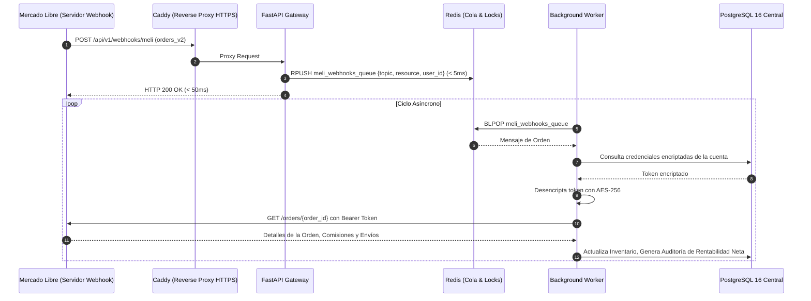

# Arquitectura del Sistema ERP Inteligente para Mercado Libre México

## 1. Principios de Diseño
- **Disponibilidad 24/7:** Aislamiento de fallos; la caída de un webhook o de la conexión a una cuenta no afecta al resto de los inquilinos.
- **Multi-Tenant Nativo:** Un solo despliegue puede servir a múltiples empresas (organizaciones SaaS) asegurando el aislamiento estricto de datos mediante `tenant_id` y `company_id`.
- **Rendimiento Asíncrono:** Mercado Libre exige tiempos de respuesta HTTP inferiores a 500 ms en webhooks. La arquitectura delega todo trabajo pesado a workers asíncronos vía Redis.
- **Seguridad en Reposo (Encryption at Rest):** Los tokens de Mercado Libre (`access_token` y `refresh_token`) se almacenan cifrados con AES-256 (Fernet) en PostgreSQL.

---

## 2. Diagrama de Flujo de Webhooks y Sincronización

---

## 3. Modelo de Aislamiento Multi-Tenant

1. **Nivel 1 - Tenant (Organización / Suscriptor SaaS):**
   - Representa el cliente que contrata el ERP.
   - Posee un plan de facturación (`standard`, `pro`, `enterprise`).
2. **Nivel 2 - Company (Empresa / RFC):**
   - Una organización puede tener múltiples razones sociales o RFCs en México.
   - Cada empresa define su régimen fiscal para el cálculo de retenciones SAT (IVA 8%/16%, ISR 1%/20%).
3. **Nivel 3 - MeliAccount (Cuentas de Vendedor):**
   - Una empresa puede tener múltiples tiendas oficiales o cuentas de Mercado Libre vinculadas simultáneamente.
4. **Nivel 4 - Product / SKU Maestro:**
   - Inventario centralizado unificado que descuenta existencias automáticamente sin importar por cuál cuenta de Mercado Libre se haya vendido.
