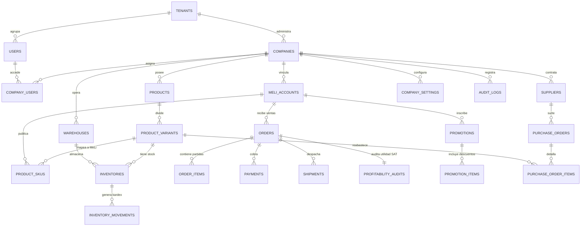

# Documentación del Modelo de Datos y Base de Datos (PostgreSQL 16)

**Sistema:** ERP Inteligente para Mercado Libre México  
**Motor:** PostgreSQL 16 (Central)  
**Total de Tablas:** 24 tablas relacionales  
**Convención de Nombres:** snake_case, claves primarias UUIDv4, marcas de tiempo UTC indexadas.

---

## 1. Diagrama Entidad-Relación (ERD)

---

## 2. Diccionario de Datos por Dominio

### A. Organizaciones, Empresas y Usuarios (Multi-Tenant)

#### 1. `tenants`
Organización o suscriptor SaaS principal del ERP.
| Columna | Tipo | Restricciones | Descripción |
| :--- | :--- | :--- | :--- |
| `id` | UUID | PRIMARY KEY | Identificador único del tenant |
| `name` | VARCHAR(200) | NOT NULL | Nombre comercial o de la organización |
| `slug` | VARCHAR(100) | UNIQUE, NOT NULL | Slug identificador de URL |
| `plan_tier` | VARCHAR(50) | NOT NULL, DEFAULT 'standard' | Nivel de suscripción (standard, pro, enterprise) |
| `is_active` | BOOLEAN | NOT NULL, DEFAULT true | Estado de la suscripción |
| `created_at` | TIMESTAMPTZ | NOT NULL, INDEX | Fecha de alta |
| `updated_at` | TIMESTAMPTZ | NOT NULL | Fecha de última modificación |

#### 2. `companies`
Razón social o empresa fiscal con RFC mexicano.
| Columna | Tipo | Restricciones | Descripción |
| :--- | :--- | :--- | :--- |
| `id` | UUID | PRIMARY KEY | Identificador de la empresa |
| `tenant_id` | UUID | FK -> tenants(id) ON DELETE CASCADE | Organización propietaria |
| `legal_name` | VARCHAR(255) | NOT NULL | Denominación o Razón Social oficial |
| `rfc` | VARCHAR(13) | NOT NULL, INDEX | RFC mexicano validado (12 o 13 caracteres) |
| `fiscal_regime`| VARCHAR(100) | NULL | Clave de régimen fiscal SAT (e.g. 626 RESICO, 601 General) |
| `email` | VARCHAR(255) | NULL | Correo de facturación / contacto |
| `phone` | VARCHAR(30) | NULL | Teléfono |
| `is_active` | BOOLEAN | NOT NULL, DEFAULT true | Estatus operativo |
| **Índice Compuesto** | `ix_companies_tenant_rfc` | UNIQUE(tenant_id, rfc) | Impide duplicar el mismo RFC dentro de una organización |

#### 3. `users`
Usuarios con acceso al sistema y roles RBAC.
| Columna | Tipo | Restricciones | Descripción |
| :--- | :--- | :--- | :--- |
| `id` | UUID | PRIMARY KEY | Identificador del usuario |
| `tenant_id` | UUID | FK -> tenants(id) ON DELETE CASCADE | Organización a la que pertenece |
| `email` | VARCHAR(255) | UNIQUE, NOT NULL | Correo electrónico de acceso |
| `password_hash`| VARCHAR(255) | NOT NULL | Hash criptográfico bcrypt |
| `full_name` | VARCHAR(150) | NOT NULL | Nombre completo |
| `role` | VARCHAR(50) | NOT NULL, DEFAULT 'operator' | Rol: admin, manager, operator, viewer |
| `is_active` | BOOLEAN | NOT NULL, DEFAULT true | Estado de la cuenta |
| `is_superuser` | BOOLEAN | NOT NULL, DEFAULT false | Privilegios globales de administración |

---

### B. Ecosistema Mercado Libre México

#### 4. `meli_accounts`
Cuentas de vendedor oficiales vinculadas mediante OAuth 2.0.
| Columna | Tipo | Restricciones | Descripción |
| :--- | :--- | :--- | :--- |
| `id` | UUID | PRIMARY KEY | Identificador de la cuenta |
| `company_id` | UUID | FK -> companies(id) ON DELETE CASCADE | Empresa a la que pertenece la tienda |
| `meli_user_id`| BIGINT | UNIQUE, NOT NULL | ID numérico del vendedor en Mercado Libre |
| `nickname` | VARCHAR(100) | NOT NULL | Nombre público de la tienda en Mercado Libre |
| `site_id` | VARCHAR(10) | NOT NULL, DEFAULT 'MLM' | Identificador de país ('MLM' para México) |
| `access_token_enc` | TEXT | NOT NULL | Token de acceso cifrado con AES-256 (Fernet) |
| `refresh_token_enc`| TEXT | NOT NULL | Refresh Token rotativo cifrado con AES-256 |
| `token_expires_at` | TIMESTAMPTZ | NOT NULL | Fecha y hora exacta de expiración (6 horas) |
| `sync_orders` | BOOLEAN | DEFAULT true | Habilitar sincronización de pedidos |
| `sync_stock` | BOOLEAN | DEFAULT true | Habilitar sincronización de inventario |
| `sync_prices` | BOOLEAN | DEFAULT true | Habilitar sincronización de precios |

---

### C. Catálogo Maestro, Variantes y SKUs

#### 5. `products`
Producto maestro central de la empresa.
| Columna | Tipo | Restricciones | Descripción |
| :--- | :--- | :--- | :--- |
| `id` | UUID | PRIMARY KEY | Identificador del producto maestro |
| `company_id` | UUID | FK -> companies(id) ON DELETE CASCADE | Empresa dueña del producto |
| `name` | VARCHAR(255) | NOT NULL | Nombre comercial |
| `brand` | VARCHAR(100) | NULL | Marca |
| `category` | VARCHAR(100) | NULL | Categoría interna |
| `description` | TEXT | NULL | Descripción detallada |

#### 6. `product_variants`
Variantes de color, talla, capacidad o presentación.
| Columna | Tipo | Restricciones | Descripción |
| :--- | :--- | :--- | :--- |
| `id` | UUID | PRIMARY KEY | Identificador de la variante |
| `product_id` | UUID | FK -> products(id) ON DELETE CASCADE | Producto maestro padre |
| `variant_name`| VARCHAR(100) | NOT NULL | Nombre (e.g. "Negro / Talla L") |
| `sku` | VARCHAR(100) | NOT NULL, INDEX | Código SKU maestro interno |
| `barcode_ean` | VARCHAR(50) | NULL, INDEX | Código de barras EAN-13 / UPC |
| `cogs_cost` | NUMERIC(12,2)| NOT NULL, DEFAULT 0.00 | Costo de adquisición unitario (MXN) |
| **Índice Compuesto** | `ix_product_variants_product_sku` | UNIQUE(product_id, sku) | Garantiza SKU único por producto |

#### 7. `product_skus`
Publicaciones mapeadas en Mercado Libre México.
| Columna | Tipo | Restricciones | Descripción |
| :--- | :--- | :--- | :--- |
| `id` | UUID | PRIMARY KEY | Identificador del mapeo |
| `meli_account_id`| UUID | FK -> meli_accounts(id) ON DELETE CASCADE | Tienda de Mercado Libre |
| `variant_id` | UUID | FK -> product_variants(id) ON DELETE CASCADE | Variante interna mapeada |
| `meli_item_id` | VARCHAR(30) | NOT NULL, INDEX | ID de publicación oficial (e.g. MLM123456789) |
| `meli_variation_id`| VARCHAR(30)| NULL | ID de variación interna en Mercado Libre |
| `seller_sku` | VARCHAR(100) | NOT NULL | SKU reportado a Mercado Libre |
| `price` | NUMERIC(12,2)| NOT NULL | Precio de venta publicado (MXN) |
| `listing_type_id` | VARCHAR(50) | DEFAULT 'gold_special' | Tipo de publicación (Clásica / Premium) |
| `logistic_type` | VARCHAR(50) | DEFAULT 'fulfillment' | Modo logístico (fulfillment, drop_off, flex) |
| **Índice Compuesto** | `ix_product_skus_meli_item` | UNIQUE(meli_account_id, meli_item_id, meli_variation_id) |

---

### D. Almacenes, Existencias y Kardex

#### 8. `warehouses`
Ubicaciones físicas y centros de distribución.
| Columna | Tipo | Restricciones | Descripción |
| :--- | :--- | :--- | :--- |
| `id` | UUID | PRIMARY KEY | Identificador del almacén |
| `company_id` | UUID | FK -> companies(id) ON DELETE CASCADE | Empresa propietaria |
| `name` | VARCHAR(150) | NOT NULL | Nombre del almacén |
| `code` | VARCHAR(50) | NOT NULL | Código único (e.g. BOD-01, MELI-FULL) |
| `warehouse_type`| VARCHAR(50) | DEFAULT 'internal' | internal, meli_fulfillment, dropship |

#### 9. `inventories`
Existencias en tiempo real por variante y almacén.
| Columna | Tipo | Restricciones | Descripción |
| :--- | :--- | :--- | :--- |
| `id` | UUID | PRIMARY KEY | Identificador de inventario |
| `warehouse_id` | UUID | FK -> warehouses(id) ON DELETE CASCADE | Almacén |
| `variant_id` | UUID | FK -> product_variants(id) ON DELETE CASCADE | Variante |
| `quantity_available`| INTEGER | NOT NULL, DEFAULT 0 | Unidades listas para venta |
| `quantity_reserved` | INTEGER | NOT NULL, DEFAULT 0 | Unidades comprometidas en órdenes |
| `safety_stock` | INTEGER | NOT NULL, DEFAULT 5 | Punto de reorden / stock de seguridad |
| **Índice Compuesto** | `ix_inventories_warehouse_variant` | UNIQUE(warehouse_id, variant_id) |

#### 10. `inventory_movements`
Pista inmutable del Kardex de inventario.
| Columna | Tipo | Restricciones | Descripción |
| :--- | :--- | :--- | :--- |
| `id` | UUID | PRIMARY KEY | Identificador del movimiento |
| `inventory_id` | UUID | FK -> inventories(id) ON DELETE CASCADE | Registro de inventario afectado |
| `movement_type`| VARCHAR(50) | NOT NULL, INDEX | PURCHASE_RECEIPT, SALE_SHIPMENT, ADJUSTMENT, RETURN |
| `quantity_delta`| INTEGER | NOT NULL | Variación (+ o -) |
| `quantity_before`| INTEGER | NOT NULL | Saldo anterior |
| `quantity_after` | INTEGER | NOT NULL | Saldo resultante |
| `reference_id` | VARCHAR(100) | NULL | ID de orden o compra vinculada |
| `user_id` | UUID | NULL | Usuario que autorizó el ajuste |

---

### E. Ventas, Pagos, Envíos y Rentabilidad SAT

#### 11. `orders`, `order_items`, `payments`, `shipments`
Gestión de ventas y paquetería de Mercado Libre.
- `orders`: Almacena `meli_order_id`, estatus, comprador y monto total.
- `order_items`: Partidas individuales con precio y comisión cobrada por Mercado Libre.
- `payments`: Pagos aprobados por Mercado Pago con fecha y comisión de procesamiento.
- `shipments`: Guías de Mercado Envíos (Full, Flex, Colecta), número de rastreo y costo asumido por el vendedor.

#### 12. `profitability_audits`
Auditoría financiera por orden vendida.
$$\text{net\_profit} = \text{gross\_sale\_price} - (\text{cogs\_total} + \text{meli\_commission\_fee} + \text{shipping\_cost\_seller} + \text{packaging\_cost} + \text{sat\_iva\_retention} + \text{sat\_isr\_retention})$$

---

### F. Proveedores, Compras, Configuraciones y Auditoría

- `suppliers`: Directorio de proveedores con RFC y tiempo de entrega en días.
- `purchase_orders` & `purchase_order_items`: Órdenes de compra para reabastecimiento automático.
- `company_settings`: Almacén clave-valor para parámetros por empresa.
- `audit_logs`: Trazabilidad inmutable de cambios (quién, qué, cuándo y diff JSON).
