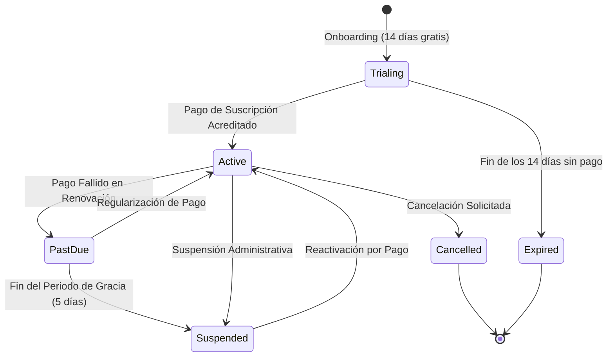

# Manual de Comercialización, Estrategia SaaS y Administración Global

**Plataforma:** ERP Inteligente Mercado Libre México (SaaS Multiempresa)  
**Versión de Estrategia:** 2026.1  
**Dirigido a:** Equipo Directivo, Fuerza Comercial, Operaciones y Soporte al Cliente  

---

## 1. Propuesta de Valor y Modelo de Negocio

El **ERP Inteligente Mercado Libre México** es una solución integral de software como servicio (SaaS) multiempresa diseñada específicamente para vendedores, distribuidores y marcas oficiales que operan en Mercado Libre México (sitio MLM).

### Diferenciales Competitivos Clave:
1. **Multi-Cuenta Oficial y Sincronización Real:** Conexión mediante OAuth 2.0 y Webhooks con tiempos de respuesta inferiores a 500 ms.
2. **Motor Financiero y Conciliación Automática:** Diferencia importe bruto, importes netos, comisiones oficiales retenidas, retenciones fiscales SAT (ISR/IVA) y liquidaciones bancarias.
3. **Logística Térmica y Envíos Full:** Generación masiva de etiquetas oficiales en formato PDF y ZPL (100x150 mm), auditoría de reimpresiones y trazabilidad de paquetes.
4. **Automatización Empresarial (ECA):** Motor de 10 reglas canónicas con Global Kill Switch, Circuit Breaker y reversibilidad automática (Rollback).
5. **Inteligencia Artificial Comercial:** Asistente con 11 herramientas backend autorizadas sin acceso directo a la base de datos, protegido contra prompt injection.
6. **Aislamiento Multi-Tenant Absoluto:** Estricta segregación de datos por `tenant_id` y `company_id`.

---

## 2. Catálogo de Planes Comerciales Configurables

> [!IMPORTANT]
> **Directriz de Precios:** No se deben fijar precios definitivos cerrados sin un análisis comercial previo del perfil, volumen transaccional y necesidades logísticas del cliente. Los precios listados a continuación representan **precios base sugeridos** de referencia en Pesos Mexicanos (MXN).

| Característica / Límite | Plan Básico | Plan Profesional *(Recomendado)* | Plan Empresarial *(Enterprise)* |
| :--- | :---: | :---: | :---: |
| **Público Objetivo** | Emprendedores y startups en Mercado Libre | Pymes y distribuidores multicanal | Grandes marcas, corporativos y tiendas oficiales |
| **Precio Base Mensual (Sugerido)** | **$499.00 MXN / mes** | **$1,499.00 MXN / mes** | **$3,999.00 MXN / mes (Base)** |
| **Precio Anual con Descuento** | $4,990.00 MXN (Ahorro de 2 meses) | $14,990.00 MXN (Ahorro de 2 meses) | Cotización anualizada personalizada |
| **Periodo de Prueba Gratuita** | **14 días** (sin tarjeta forzosa) | **14 días** (sin tarjeta forzosa) | **30 días asistidos** |
| **Usuarios Operativos Permitidos** | **Hasta 3 usuarios** | **Hasta 10 usuarios** | **Ilimitados (-1)** |
| **Cuentas de Mercado Libre** | **1 cuenta MLM** | **Hasta 5 cuentas MLM** | **Ilimitadas (-1)** |
| **Almacenamiento Seguro en la Nube** | **1 GB (1,024 MB)** | **10 GB (10,240 MB)** | **100 GB+ Dedicado** |
| **Límite de Pedidos Mensuales** | 1,000 pedidos / mes | 15,000 pedidos / mes | **Ilimitado (-1)** |
| **Límite de Sincronizaciones / mes** | 5,000 eventos / mes | 50,000 eventos / mes | **Ilimitado (-1)** |
| **Motor de Automatización (ECA)** | ❌ No disponible | ✅ **Incluido completo** | ✅ **Incluido con límites extendidos** |
| **Asistente de Inteligencia Artificial** | ❌ No disponible | ✅ **Incluido completo** | ✅ **Incluido + Modelos personalizados** |
| **Logística Térmica y Etiquetas PDF/ZPL**| ✅ Formato individual | ✅ **Lotes masivos y plantillas** | ✅ **Lotes masivos + API dedicada** |
| **Administrador Comercial & Precios** | Básico | ✅ **Dinámico + Simulador** | ✅ **Dinámico multitienda avanzado** |
| **Soporte Técnico y SLA** | Correo (Respuesta en 24h) | WhatsApp prioritario (4h) | **Gerente de cuenta dedicado (SLA 99.9%)** |

---

## 3. Estrategia de Análisis Comercial y Precios Personalizados

El sistema incorpora en su modelo de datos y endpoints administrativos la capacidad de establecer **cotizaciones personalizadas** (`custom_price_mxn`) y **descuentos especiales** (`discount_percent`).

### Criterios para el Análisis Comercial antes de fijar precio final:
1. **Volumen de Facturación en Mercado Libre:** Clientes con facturación mayor a $500,000 MXN mensuales pueden ser candidatos a esquemas de tarifa plana con cuota por volumen adicional.
2. **Número de RFCs / Empresas Filiales:** Clientes corporativos con múltiples personas morales o físicas (Multi-RFC) dentro de una misma organización.
3. **Múltiples Almacenes Físicos:** Operaciones con bodegas en distintas ciudades o centros de fulfillment externos.
4. **Compromiso de Permanencia Anual:** Se recomienda aplicar un descuento del **15% al 25%** en contrataciones anuales pagadas por adelantado vía SPEI o tarjeta de crédito.

---

## 4. Gestión de Pagos y Facturación SaaS Independiente

> [!NOTE]
> **Separación Absoluta:** La facturación y cobro por el uso de la plataforma SaaS está **100% aislada** de las ventas, comisiones y finanzas en Mercado Libre de cada empresa cliente.
> - La tabla `saas_invoices` registra las facturas emitidas por la empresa proveedora del software al cliente.
> - La tabla `saas_payments` registra los cobros procesados con cálculo de IVA al 16% mexicano.

### Proveedores de Pago Autorizados Soportados:
1. **Stripe México:**
   - Cobro recurrente automático con tarjeta de débito y crédito (Visa, Mastercard, AMEX).
   - Manejo de reintentos con webhook `invoice.payment_succeeded` y `invoice.payment_failed`.
2. **Mercado Pago Subscriptions:**
   - Pago mediante dinero en cuenta de Mercado Pago, tarjeta o débito bancario.
3. **Transferencia Interbancaria SPEI (Manual / Asistida):**
   - Ideal para clientes del Plan Empresarial con órdenes de compra corporativas y pago a 15 o 30 días de crédito.
   - El administrador registra el pago en el Panel Global con folio de rastreo CEP de Banxico.

---

## 5. Ciclo de Vida de las Suscripciones

### Reglas de Acceso según Estado:
- **`trialing` / `active`:** Acceso total a los módulos y cuotas contratadas en su plan.
- **`past_due`:** Periodo de gracia de 5 días naturales con recordatorios visuales en el header del ERP; las operaciones continúan activas.
- **`suspended`:** El motor de cuotas (`QuotaEnforcementService`) **bloquea inmediatamente todas las operaciones de escritura** (creación de pedidos, actualización de inventario, cambio de precios, generación de guías). Se permite únicamente consulta de datos históricos y acceso al portal de pago.
- **`cancelled` / `expired`:** La organización es archivada. Sus datos se preservan íntegros bajo política de retención de 90 días antes de purga definitiva.

---

## 6. Panel Global de Administración SaaS (Platform Owner)

Los usuarios con rol `platform_owner` o `saas_admin` disponen de herramientas especializadas para el gobierno comercial de la plataforma en la ruta `/app#saas`:

### Funcionalidades del Panel Global:
1. **Métricas en Tiempo Real:**
   - **MRR (Monthly Recurring Revenue):** Suma del ingreso mensual recurrente activo en MXN.
   - **ARR (Annual Recurring Revenue):** MRR anualizado (MRR × 12).
   - **ARPU (Average Revenue Per User):** Ingreso promedio generado por cliente activo.
   - **Churn Rate:** Porcentaje de cancelaciones respecto al total histórico.
2. **Directorio de Clientes:**
   - Buscador en tiempo real por nombre, slug de organización o correo del administrador.
   - Estado de la cuenta con distintivos visuales (Activo, Trial, Suspendido).
3. **Acciones Administrativas de un Clic:**
   - **Suspender:** Pausa inmediata de la suscripción con captura de motivo auditable.
   - **Reactivar:** Restauración instantánea del servicio.
   - **Extender Prueba (+14 Días):** Concesión de prórroga comercial para cierre de ventas.
   - **Emitir Factura SaaS:** Emisión manual de factura de servicio con IVA desglosado.
   - **Cotización Personalizada:** Fijación de precios y descuentos especiales sin romper los planes estándar.
